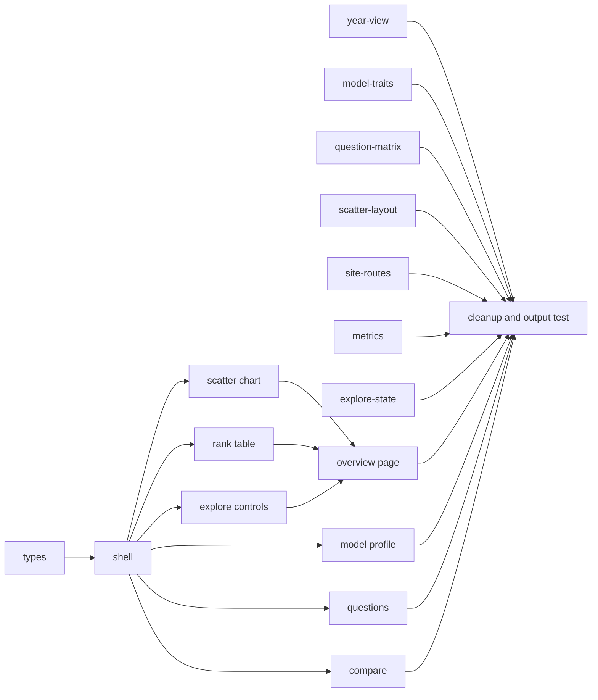

# UI rebuild plan

**Goal:** Replace the single-page dashboard with year-scoped pages (overview explorer, model profile, question grid, question page, compare) that visitors can customize, on desktop and phone.
**Architecture:** Pure logic in `web/lib/*.mjs` (typed by sibling `.d.mts`), tested with `node --test`. Server pages build slim props from the export JSON at build time; client components hold explore state in the query string.
**Tech stack:** Next.js 15 static export, React 19, TypeScript, CSS Modules + CSS variables. No new dependencies.
**Spec:** docs/plans/2026-11-22-ui-rebuild.spec.md
**Detail:** contracts
**Target-min:** 14

## Global constraints

- Language: JavaScript ESM (`.mjs`) for lib, TSX for UI. Lib test command: `node --test benchmark/test/<name>.test.mjs`. UI check: `cd web && npx tsc --noEmit`.
- Types come only from `web/lib/site-types.d.mts` (spec §8). Do not change a signature.
- Never edit: `exams/**`, `results/**`, `benchmark/*.mjs`, `web/public/data/**`, `web/app/globals.css`, files another task owns.
- New UI uses only tokens from `web/app/(site)/tokens.css` and its own `*.module.css`. No Mantine, Tailwind or chart library. Charts are inline SVG.
- UI text is Korean, plain sentences. Numbers use `font-variant-numeric: tabular-nums`.
- Mobile (spec §10): at widths under 640px the body never scrolls sideways; tap targets are at least 44px high; hover content is reachable by tap or focus.
- Status is never colour alone: correct `○`, incorrect `×`, abstained `–`, error `!`.
- Internal links use `next/link` with paths from `site-routes.mjs`.
- Ruling: detail is contracts - lib functions are small and the UI has no unit-test harness - a vague case costs one fix round.
- Ruling: sequential [chain-b93f] - pages import the shell and the overview imports its three components, and `tsc` needs real files - the UI half runs in four steps instead of one.
- Ruling: accept the plan over the 15k cap - 17 tasks with contract tests do not fit, and the dispatched blocks are frozen - the shared prime is larger.
- Ruling: UI tasks are checked by `tsc` and by the T16 build-output test - JSX cannot run under `node --test` without a new dependency - layout defects surface only in manual review.

## Main diagram

```mermaid
%% schedule
gantt
  title Predicted schedule (mm:ss)
  dateFormat X
  axisFormat %M:%S
  section lane 1
  T3 question-matrix :t3, 0, 114s
  T10 rank table :t10, 314, 186s
  T12 overview page :t12, 501, 213s
  T16 cleanup and output test :t16, 714, 171s
  section lane 2
  T1 year-view :t1, 0, 111s
  T14 questions :t14, 314, 186s
  section lane 3
  T2 model-traits :t2, 0, 109s
  T13 model profile :t13, 314, 184s
  section lane 4
  T7 explore-state :t7, 0, 109s
  T11 explore controls :t11, 314, 160s
  section lane 5
  T4 scatter-layout :t4, 0, 107s
  T15 compare :t15, 314, 156s
  section lane 6
  T6 metrics :t6, 0, 104s
  T9 scatter chart :t9, 314, 152s
  section lane 7
  T0 types :t0, 0, 97s
  T8 shell :t8, 97, 217s
  section lane 8
  T5 site-routes :t5, 0, 94s
```

critical path: T0 → T8 → T10 → T12 → T16 (14.7 min) · peak width 8 · predicted build 14.7 min · predicted total ≈ 18.2 min (target ✗ 14.0)

## File structure

`web/lib/<name>.mjs` + `.d.mts`: one pure module each (T0-T7). `web/lib/site-data.ts`: loads the four JSON files once. `web/app/(site)/`: new pages. `web/app/(legacy)/`: archive, debates, research, unchanged. `web/components/site/`: new components, one `.tsx` + `.module.css` each.

## Lib

**Probe entry:** call=web/lib/year-view.mjs buildYearView

### T0 types · Complexity 1 · Est. context 24k
**Owns:** web/lib/site-types.d.mts, web/lib/year-view.d.mts, web/lib/model-traits.d.mts, web/lib/question-matrix.d.mts, web/lib/scatter-layout.d.mts, web/lib/site-routes.d.mts, web/lib/metrics.d.mts, web/lib/explore-state.d.mts
**Components:** 1
**LOC owned:** 110
**Tests:** fast
**Kind:** mechanical
**Model:** haiku
**Produces:** site-types.d.mts (the two code blocks of spec §8 verbatim, with the three `ModelSummary` fields and `kind` added as that section says)
**Test code:** `cd web && npx tsc --noEmit` exits 0. Each other `.d.mts` declares exactly the Produces lines of T1-T7, importing types from `./site-types.mjs`.

### T1 year-view · Complexity 4 · Est. context 34k
**Owns:** web/lib/year-view.mjs, benchmark/test/year-view.test.mjs
**Components:** 1
**LOC owned:** 170
**Tests:** fast
**Model:** sonnet
**Produces:** buildYearView(main: BenchmarkComparison, period4: BenchmarkComparison | null) -> YearView · slimModel(m: ModelView) -> ModelSummary · latestYearWithResults(views: YearView[]) -> number
- e.g. buildYearView(fixture2026, null).models[0] -> {id:"a", provider:"OpenAI", score:376, maxScore:376, period4:null, subjects:{korean:{pct:96, tracks:[…2]}}}
- e.g. latestYearWithResults([{year:2026, models:[m]}, {year:2027, models:[]}]) -> 2026
**Test code:** `sorts_by_score_then_cost`: scores 300/$1, 376/$4, 376/$3 give ids in order 376/$3, 376/$4, 300. `subject_pct_averages_tracks`: korean tracks 92 and 100 of 100 give pct 96. `period4_only_model_listed_last`: model present only in period4 has score null, period4 {score,max}, comes after scored models. `pending_from_requested`: requested_models with state pending and no report appear in `pending`. `provider_prefixes`: ids gpt-x, claude-x, gemini-x, zzz give OpenAI, Anthropic, Google, 기타 (spec §9). `tokens_sum`: usage input 10, output 5 give inputTokens 10, outputTokens 5. `slim_drops_questions`: result has no `questions` key.
**Review Focus:** `missing_summary_fields_null`: a report without estimated_cost_usd gives costUsd null, not 0.

### T2 model-traits · Complexity 4 · Est. context 32k
**Owns:** web/lib/model-traits.mjs, benchmark/test/model-traits.test.mjs
**Components:** 1
**LOC owned:** 150
**Tests:** fast
**Model:** sonnet
**Produces:** modelTraits(model: ModelView, cohort: ModelView[]) -> Trait[] · soloWrong(model: ModelView, cohort: ModelView[]) -> string[]
- e.g. modelTraits(perfect, cohort)[0] -> {key:"perfect", tone:"good", label:"만점", sentence:"147문항을 모두 맞혔다."}
- e.g. soloWrong(m, cohort) -> ["2026-math-common-q22"]
**Test code:** one test per row of the table in spec §4, each with the threshold value passing and the value just outside failing (e.g. `abstains_at_5_not_4`, `value_needs_90pct_and_half_median_cost`, `weak_subject_below_60_or_25_under_best`). `order_follows_table`: a model matching perfect and fast returns keys ["perfect","fast"]. `abstains_sentence`: abstained 10, correct 130, incorrect 7 give "10문항에서 답을 내지 않았다. 답한 137문항의 정답률은 94.9%다."
**Review Focus:** `median_ignores_null_cost`; `single_model_cohort_has_no_solo_wrong`.

### T3 question-matrix · Complexity 5 · Est. context 36k
**Owns:** web/lib/question-matrix.mjs, benchmark/test/question-matrix.test.mjs
**Components:** 1
**LOC owned:** 190
**Tests:** fast
**Model:** sonnet
**Produces:** questionMatrix(view: YearView, subject: SubjectKey) -> Matrix · questionDetail(view: YearView, id: string) -> QuestionDetail | null · compareData(view: YearView) -> CompareData · disagreements(data: CompareData, ids: string[]) -> string[] · filterQuestions(data: CompareData, f: QuestionFilter) -> string[] · rescore(data: CompareData, questionIds: string[]) -> Record<string, Rescore>
- e.g. disagreements(data, ["a","b"]) -> ["2026-korean-common-q07"]
- e.g. rescore(data, ["q1","q2"]) -> {a:{correct:1,total:2,points:2,maxPoints:5}}
- e.g. filterQuestions(data, {subjects:[], minPoints:3, kind:null, minMissShare:null}) -> ["q2"]
**Test code:** `matrix_columns_ordered_by_section_then_number` (common before electives); `miss_count_counts_non_correct`; `cell_null_when_model_lacks_question`; `detail_unknown_id_null`; `disagree_on_status_or_answer`: same status with answers 2 and 4 is a disagreement, both correct is not; `filter_min_miss_share_0_5`: question missed by 1 of 2 models passes, by 0 of 2 fails; `filter_empty_matches_all`; `rescore_skips_models_without_question`.

### T4 scatter-layout · Complexity 5 · Est. context 30k
**Owns:** web/lib/scatter-layout.mjs, benchmark/test/scatter-layout.test.mjs
**Components:** 1
**LOC owned:** 140
**Tests:** fast
**Model:** sonnet
**Produces:** scatterLayout(points: {id: string; x: number; y: number}[], opts: {width: number; height: number; pad: number; xLog: boolean; yLog: boolean; labelWidth: (id: string) => number}) -> PlacedPoint[] · axisTicks(min: number, max: number, log: boolean) -> number[]
- e.g. axisTicks(0.06, 8.5, true) -> [0.1, 0.3, 1, 3]
- e.g. scatterLayout([{id:"a",x:1,y:1}], o)[0] -> {id:"a", x:300, y:200, labelX:309, labelY:204, anchor:"start"}
**Test code:** `log_scale_positions`: x values 0.1,1,10 are equally spaced; `labels_do_not_overlap`: four points with equal y and close x get label boxes (labelWidth × 14px) that do not intersect each other or any point; `label_stays_inside_box`: a point at the right edge gets anchor "end"; `single_value_domain_centres`; `nonpositive_on_log_dropped`.

### T5 site-routes · Complexity 2 · Est. context 26k
**Owns:** web/lib/site-routes.mjs, benchmark/test/site-routes.test.mjs
**Components:** 1
**LOC owned:** 70
**Tests:** fast
**Kind:** mechanical
**Model:** haiku
**Produces:** yearPath(year: number) -> string · modelPath(year: number, id: string) -> string · questionsPath(year: number, subject?: string) -> string · questionPath(year: number, questionId: string) -> string · comparePath(year: number, ids: string[]) -> string · parseCompare(search: string) -> string[] · legacyRedirect(search: string, hash: string) -> string | null
**Test code:** `modelPath(2026,"gpt-6.1-sol")` -> "/2026/models/gpt-6.1-sol"; `questionsPath(2026,"math")` -> "/2026/questions?subject=math"; `comparePath(2026,["a","b"])` -> "/2026/compare?models=a,b"; `parseCompare("?models=a,b,a,c,d,e")` -> ["a","b","c","d"]; `legacyRedirect("?year=2026&model=x","#model-records")` -> "/2026/models/x"; `legacyRedirect("?year=2027&session=period4","")` -> "/2027"; `legacyRedirect("?x=1&y=cost","")` -> null; `legacyRedirect("","#research")` -> null (spec §1).

### T6 metrics · Complexity 3 · Est. context 28k
**Owns:** web/lib/metrics.mjs, benchmark/test/metrics.test.mjs
**Components:** 1
**LOC owned:** 110
**Tests:** fast
**Model:** sonnet
**Produces:** metricsFor(subjects: SubjectKey[], filtered: boolean) -> Metric[] · metricValue(m: ModelSummary, key: MetricKey, rescored: Rescore | null) -> number | null · formatMetric(key: MetricKey, value: number | null) -> string
- e.g. metricValue({score:368, costUsd:0.92}, "costPerPoint", null) -> 0.0025
- e.g. formatMetric("wall", 4329) -> "1시간 12분"
**Test code:** `filtered_metrics_only_when_filtered`: fAccuracy and fPoints absent when filtered false; `subject_metric`: "subj:korean" returns subjects.korean.pct, null when absent; `accuracy_pct`: correct 130 of 147 -> 88.4; `abstention_pct`; `cost_and_wall_are_log_low_better`; `format_cost` 0.3 -> "$0.30"; `format_null` -> "–"; `fAccuracy_from_rescore` {correct:1,total:2} -> 50.

### T7 explore-state · Complexity 4 · Est. context 30k
**Owns:** web/lib/explore-state.mjs, benchmark/test/explore-state.test.mjs
**Components:** 1
**LOC owned:** 150
**Tests:** fast
**Model:** sonnet
**Produces:** DEFAULT_EXPLORE: ExploreState · parseExplore(search: string) -> ExploreState · serializeExplore(s: ExploreState) -> string · PRESETS: {id: string; label: string; patch: Partial<ExploreState>}[]
- e.g. serializeExplore(DEFAULT_EXPLORE) -> ""
- e.g. parseExplore("?x=wall&p=OpenAI,Google&qmin=3").x -> "wall"
**Test code:** `round_trip`: parse(serialize(s)) deep-equals s for a state with every field set; `defaults_omitted`; `unknown_metric_falls_back`: "?x=bogus" gives x "cost"; `caps`: more than 8 cols or 50 picked ids are truncated; `presets_match_spec`: five presets with the axes and filter of spec §9; `legacy_keys_ignored`: "?year=2026&model=a" parses to DEFAULT_EXPLORE.
**Review Focus:** `hostile_values`: "?qmiss=NaN&max=-1&open=<script>" gives nulls and open kept as plain text only.

## UI

**Probe entry:** run=cd web && npx tsc --noEmit

### T8 shell · Complexity 5 · Est. context 46k
**Owns:** web/app/layout.tsx, web/app/(site)/layout.tsx, web/app/(site)/tokens.css, web/app/(legacy)/layout.tsx, web/app/(legacy)/**, web/lib/site-data.ts, web/components/site/SiteHeader.tsx, web/components/site/SiteHeader.module.css, web/components/site/ThemeToggle.tsx, web/components/site/primitives.tsx, web/components/site/primitives.module.css
**Components:** 3
**LOC owned:** 330
**Tests:** slow
**Model:** sonnet
**Consumes:** buildYearView (T1) · yearPath, questionsPath, comparePath (T5)
**Produces:** siteData.yearViews() -> YearView[] · siteData.getYear(year: number) -> YearView · `<SiteHeader year years />` · `<TraitTags traits />` · `<SubjectBars subjects order />` · `<OutcomeBar correct incorrect abstained errors />` · `<StatusMark status />`
**Test code:** `cd web && npx tsc --noEmit` exits 0 and `npm run build` succeeds with `out/archive.html`, `out/debates/english-q37.html`, `out/research/common-errors.html` present.
**Notes:** `git mv` `app/archive`, `app/debates`, `app/research` into `app/(legacy)/`. Root layout keeps metadata and Analytics only; the legacy layout keeps Mantine and `globals.css`; the site layout imports `tokens.css`. Tokens: light and dark via `prefers-color-scheme` plus `:root[data-theme]`; ThemeToggle sets `data-theme` and `data-mantine-color-scheme` and stores the choice. Header: brand, year switch, links 개요 / 문항 / 비교 / 연구 / 아카이브; under 640px the links collapse into a menu button. Neutral cool-grey palette with one blue accent (spec §7).

### T9 scatter chart · Complexity 5 · Est. context 36k
**Owns:** web/components/site/MetricScatter.tsx, web/components/site/MetricScatter.module.css
**Components:** 1
**LOC owned:** 200
**Tests:** slow
**Model:** sonnet
**Consumes:** scatterLayout, axisTicks (T4) · formatMetric (T6)
**Produces:** `<MetricScatter points xMetric yMetric picked onPick />` where points: {id: string; x: number | null; y: number | null}[]
**Test code:** `cd web && npx tsc --noEmit` exits 0.
**Notes:** Spec §2 and §10. Measures its container with ResizeObserver and re-runs the layout; under 640px keeps labels only for picked ids and the top three by y. Points are focusable buttons; hover, focus and tap show a tooltip. Unpicked points dim when `picked` is non-empty. Lists the count of models dropped for null values under the chart.

### T10 rank table · Complexity 5 · Est. context 40k
**Owns:** web/components/site/RankTable.tsx, web/components/site/RankTable.module.css, web/components/site/ModelPanel.tsx, web/components/site/ModelPanel.module.css
**Components:** 2
**LOC owned:** 280
**Tests:** slow
**Model:** sonnet
**Consumes:** metricValue, formatMetric (T6) · modelPath, comparePath (T5) · TraitTags, SubjectBars, OutcomeBar (T8)
**Produces:** `<RankTable rows cols sort asc open rescored onSort onOpen />` where rows: (ModelSummary & {traits: Trait[]})[]
**Test code:** `cd web && npx tsc --noEmit` exits 0.
**Notes:** Spec §2 and §10. At 640px and wider a table with sortable header buttons (`aria-sort`); below that a card list with a sort select. A row or card toggles `ModelPanel` under it (`aria-expanded`): trait sentences, track scores, OutcomeBar, engine / effort / input mode, links to the profile and to compare.

### T11 explore controls · Complexity 5 · Est. context 38k
**Owns:** web/components/site/ExploreControls.tsx, web/components/site/ExploreControls.module.css
**Components:** 1
**LOC owned:** 260
**Tests:** slow
**Model:** sonnet
**Consumes:** PRESETS, DEFAULT_EXPLORE (T7) · metricsFor (T6)
**Produces:** `<ExploreControls state metrics providers engines models matchCount onChange />`
**Test code:** `cd web && npx tsc --noEmit` exits 0.
**Notes:** Spec §9 and §10. Preset buttons in one horizontally scrollable row, then four groups: 축, 모델, 열, 문항 조건. At 640px and wider the groups sit in an inline toolbar of `
` popovers; below that one button opens a bottom sheet (`role="dialog"`, closes on Escape and backdrop tap, returns focus). Shows "조건에 맞는 n문항 기준" when a question filter is set, and a 초기화 button when state differs from the default.

### T12 overview page · Complexity 5 · Est. context 44k
**Owns:** web/app/(site)/page.tsx, web/app/(site)/[year]/page.tsx, web/components/site/Explorer.tsx, web/components/site/Explorer.module.css, web/components/site/MethodNotes.tsx, web/components/site/ResearchLinks.tsx, web/components/site/LegacyRedirect.tsx
**Components:** 3
**LOC owned:** 300
**Tests:** slow
**Model:** sonnet
**Consumes:** siteData (T8) · slimModel, latestYearWithResults (T1) · modelTraits (T2) · compareData, filterQuestions, rescore (T3) · parseExplore, serializeExplore (T7) · metricsFor, metricValue (T6) · legacyRedirect (T5) · MetricScatter (T9) · RankTable (T10) · ExploreControls (T11)
**Test code:** `cd web && npx tsc --noEmit` exits 0.
**Notes:** Spec §1, §2, §9. Server pages pass slim rows, traits and `compareData` only; never `ModelView.questions`. `Explorer` (client) reads the query on mount and on `popstate`, writes with `history.replaceState`, applies filters to rows, and feeds chart and table. The headline sentence is computed from data (count of perfect scores and their cost range). `MethodNotes` copies the method, cost-basis and "정답률과 원점수의 차이" paragraphs word for word from the working-tree `web/components/ComparisonDashboard.tsx`. Sections keep ids `comparison` and `research`. A year with no models renders the pending list only. `generateStaticParams` lists every year; `dynamicParams = false`.

### T13 model profile · Complexity 4 · Est. context 40k
**Owns:** web/app/(site)/[year]/models/[model]/page.tsx, web/components/site/ModelProfile.tsx, web/components/site/ModelProfile.module.css, web/components/site/RecordList.tsx
**Components:** 2
**LOC owned:** 260
**Tests:** slow
**Model:** sonnet
**Consumes:** siteData (T8) · modelTraits (T2) · questionPath, comparePath (T5) · formatMetric (T6) · TraitTags, SubjectBars, OutcomeBar, StatusMark (T8)
**Test code:** `cd web && npx tsc --noEmit` exits 0.
**Notes:** Spec §3. `RecordList` (client) groups records by subject and defaults to non-correct only; explanations render through the existing `MathContent`.

### T14 questions · Complexity 5 · Est. context 42k
**Owns:** web/app/(site)/[year]/questions/page.tsx, web/app/(site)/[year]/questions/[id]/page.tsx, web/components/site/QuestionGrid.tsx, web/components/site/QuestionGrid.module.css, web/components/site/QuestionAnswers.tsx, web/components/site/QuestionAnswers.module.css
**Components:** 2
**LOC owned:** 280
**Tests:** slow
**Model:** sonnet
**Consumes:** siteData (T8) · questionMatrix, questionDetail (T3) · questionPath, modelPath (T5) · StatusMark (T8)
**Test code:** `cd web && npx tsc --noEmit` exits 0.
**Notes:** Spec §5. The grid is client-side with subject tabs from `?subject=`; sticky model column; scrolls inside its own box. The question page shows `QuestionNote` when `question-notes.ts` has the id and links the official source from `sources`.

### T15 compare · Complexity 4 · Est. context 38k
**Owns:** web/app/(site)/[year]/compare/page.tsx, web/components/site/CompareView.tsx, web/components/site/CompareView.module.css
**Components:** 1
**LOC owned:** 230
**Tests:** slow
**Model:** sonnet
**Consumes:** siteData (T8) · compareData, disagreements (T3) · parseCompare, comparePath, questionPath (T5) · metricValue, formatMetric (T6) · SubjectBars, StatusMark (T8)
**Test code:** `cd web && npx tsc --noEmit` exits 0.
**Notes:** Spec §6. Client component inside `<Suspense>`; a model picker (2-4) rewrites `?models=`. With fewer than two models it shows the picker and a one-line prompt.

### T16 cleanup and output test · Complexity 4 · Est. context 40k
**Owns:** web/test/site-output.test.mjs, web/package.json, web/package-lock.json, web/postcss.config.mjs, .github/workflows/deploy-pages.yml, web/README.md, CLAUDE.md, benchmark/test/academic-year.test.mjs, benchmark/test/model-link.test.mjs, web/lib/academic-year.mjs, web/lib/academic-year.d.mts, web/lib/model-link.mjs, web/lib/model-link.d.mts, web/components/AcademicYearDashboard.tsx, web/components/ComparisonDashboard.tsx, web/components/OverviewCharts.tsx, web/components/SubjectScoreMatrix.tsx, web/components/ResearchSection.tsx, web/components/ResearchSection.module.css, web/components/ResearchContent.tsx, web/components/ModelIntro.tsx, web/components/ModelExecutionDetails.tsx
**Components:** 2
**LOC owned:** 160
**Tests:** slow
**Model:** sonnet
**Test code:** after `cd web && npm run build`, `node --test web/test/site-output.test.mjs`: `routes_exist`: `out/index.html`, `out/2025.html`, `out/2026.html`, `out/2027.html`, `out/2026/models/gpt-6.1-sol.html`, `out/2026/questions.html`, `out/2026/questions/2026-english-english-q37.html`, `out/2026/compare.html`; `home_has_anchors`: index.html contains `id="research"` and `id="comparison"`; `method_note_kept`: 2026.html contains "정답률과 원점수의 차이"; `no_question_payload_on_home`: 2026.html is under 600 KB; `legacy_pages_kept` as in T8. `npm test --prefix benchmark` and `node --test research/*/publication.test.mjs` pass.
**Notes:** Spec §7, §11. Delete only files no remaining import uses (check with `tsc`); keep anything `(legacy)` still imports. Remove `tailwindcss`, `@tailwindcss/postcss`, `recharts`, `@mantine/charts`. Add the output test to the workflow after the build. Update the web section of CLAUDE.md and `web/README.md`.

## Review Focus

- lib (library): numeric (medians, log scale, rounding), state (null fields, empty cohorts), encoding (query-string parsing).
- UI (web UI): encoding (model explanations are untrusted text, rendered as text), protocol (query-string state survives reload and back).

## Self-review

Spec §1-§11 each map to a task. Lib tasks have no edges; UI waits only for the shell it imports.
