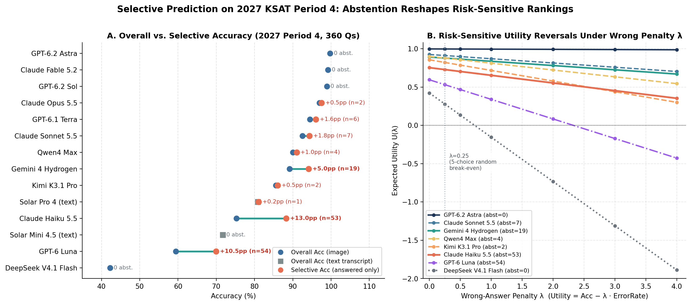
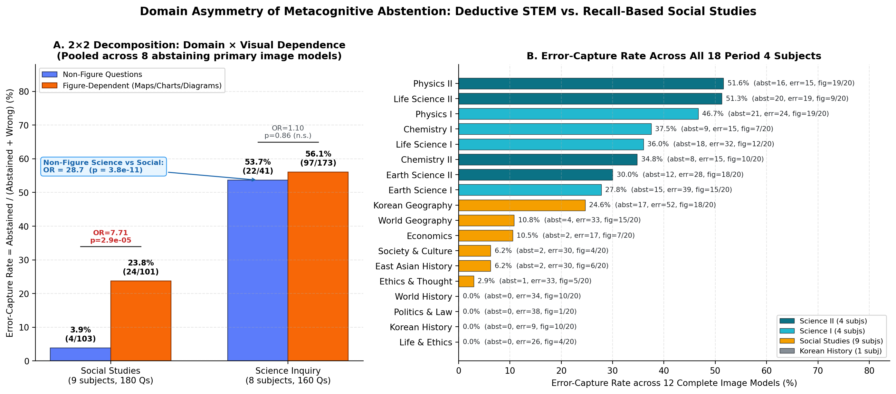
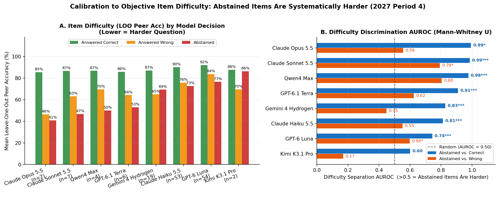
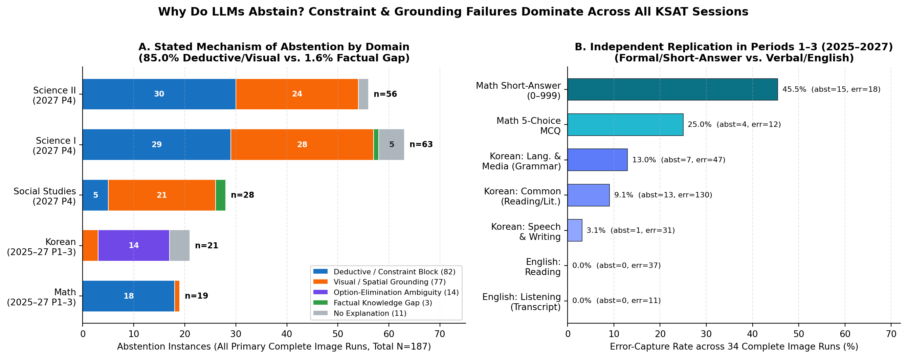

# 고난도 다학제 시험에서 LLM은 "자신이 모르는 것"을 아는가?

**수능(2025–2027학년도) 1–3교시 및 4교시 18과목 저장 답안에 대한 메타인지적 기권(Metacognitive Abstention) 실증 연구**

2026-11-22 · 저장 답안 기반 탐색·통계 연구 · 추가 모델 호출 없음

---

## 초록 (Executive Summary)

대규모 언어모델(LLM)은 자신이 모르는 질문에 직면했을 때 환각이나 추측 대신 스스로 기권(abstention)할 수 있는가? 본 연구는 `KSAT-AI-Benchmark`에 축적된 **3개 학년도(2025·2026·2027) 1–3교시(국어·수학·영어, 각 147문항)와 2027학년도 4교시 Closed-Book 전 과목(한국사·사회탐구 9과목·과학탐구 8과목, 총 360문항)**의 58개 정제 실행 스냅샷(주 분석 패널: 완료 이미지 모델 46개 실행, 총 187건의 자발적 기권)을 분석했다.

핵심 발견은 네 가지다.

1. **영역 비대칭성 (Known Unknowns vs. Unknown Unknowns):** 2027학년도 4교시 기권 발생 모델(8개)을 통합한 오답 포착률($\text{ECR} = \frac{\text{기권}}{\text{기권}+\text{오답}}$)은 과학탐구 **55.6%**(119/214)인 반면 사회탐구 **13.7%**(28/204)로 극단적 격차를 보였다(Fisher's exact test $\text{OR}=7.87$, $p=1.76\times 10^{-12}$). 개별 모델 수준에서도 `claude-haiku-5-5`($\text{OR}=15.82$, $p=2.36\times 10^{-8}$)와 `gpt-6-luna`($\text{OR}=21.06$, $p=1.06\times 10^{-12}$)에서 강하게 재현되었다.
2. **2×2 요인 분해 (도메인 × 도표 의존성):** 문항을 비도표(`non-figure`)와 도표·지도 의존(`figure_dependent`)으로 층화한 결과, **과학탐구는 비도표 문항에서도 ECR 53.7%(22/41)로 도표 문항(56.1%, 97/173)과 통계적 차이가 없었다**($\text{OR}=1.10$, $p=0.86$). 반면 **사회탐구는 비도표 문항에서 ECR이 3.9%(4/103)로 붕괴**했지만(비도표 과탐 대비 $\text{OR}=28.66$, $p=3.81\times 10^{-11}$), **지도·그래프가 포함된 사회탐구 문항에서는 23.8%(24/101)로 6배 상승**했다($\text{OR}=7.71$, $p=2.86\times 10^{-5}$).
3. **기권의 메커니즘과 난이도 정합성:** 완료 이미지 실행의 전체 기권 해설 187건을 분류한 결과, **85.0%**가 **연역·계산 제약 도출 실패(82건, 43.9%)** 또는 **시각·공간 판독/대응 실패(77건, 41.2%)**였다. 순수 사실·기억 부족을 명시한 기권은 **단 3건(1.6%)**에 불과했다. 그럼에도 기권이 발생할 때는 무작위 회피가 아니라 동료 모델 기준 객관적 고난도 문항을 정확히 겨냥했다(2027 4교시 주요 기권 모델의 Leave-One-Out AUROC `0.74`–`0.99`, 대부분 $p<0.001$).
4. **기권 억제 편향과 위험 민감 순위 역전:** 동일한 기권 허용 프롬프트 아래에서도 `deepseek-v4.1-flash`(4교시 208오답·0기권)처럼 기권이 전혀 발동하지 않는 모델군이 존재했다. 오답 페널티 $\lambda$를 도입한 효용($U_\lambda = \text{정답률} - \lambda\cdot\text{오답률}$)에서는 추측 중립점($\lambda=0.25$)에서 `gemini-4-hydrogen`이 `qwen4-max`를 추월하고, 고위험 구간($\lambda=4.0$)에서는 원점수 10.3%p 낮았던 `claude-haiku-5-5`가 `kimi-k3.1-pro`를 역전했다.

> **결론적 가설:** 현재 LLM의 자발적 기권은 "내부 사실 지식의 결여를 스스로 성찰하는 능력"이라기보다, **풀이 과정에서 발생하는 명시적 연역·수치 제약의 충돌(STEM)과 외부 시각·도표 앵커의 판독 실패(지도·그래프)**에 의해 촉발되는 **제약 기반 자기검증(Constraint-Driven Abstention)**에 가깝다. 따라서 제약 검증이 불가능한 개념·사실 회상 영역(정치와 법, 세계사, 생활과 윤리, 한국사, 영어 독해 등)에서는 '모르는지도 모른 채 틀리는(Unknown Unknowns)' 사각지대가 구조적으로 남아 있다.

---

## 1. 자료와 연구 방법

### 1.1 고정 스냅샷과 패널 구성
저장소 루트의 공식 데이터셋 4종, 전사본 `figure_dependent` 매니페스트 3종, 그리고 아카이브 디렉토리(`.timeout*`, `.guard*`, `.interrupted*` 4건)를 제외한 58개 정제 `run.json`을 [`inputs/`](inputs/manifest.json)에 동결하고 모든 원본·스냅샷 파일의 SHA-256 해시를 기록했다. 분석 스크립트([`analyze.py`](analyze.py))는 실행 시마다 스냅샷 해시를 검증하며, 추가 모델 호출이나 기존 결과·웹 파일 수정은 일절 수행하지 않았다.

| 분석 패널 | 고유 문항 수 | 도표 의존 문항 (`figure_dependent`) | 주 분석 완료 이미지 실행 | 완료 텍스트 전사본 실행 | 미완료 실행 (감도 참고) |
| --- | ---: | ---: | ---: | ---: | ---: |
| `2025:period1-3` | 147 | 미제공 | 9 | 0 | 0 |
| `2026:period1-3` | 147 | 22 | 10 | 1 (`solar-pro-4`) | 3 (`glm-5.3-flash`, `qwen3.8-27b`, `k-exaone-2.5`) |
| `2027:period1-3` | 147 | 18 | 15 | 2 (`solar-pro-4`, `solar-mini-4-5-preview`) | 0 |
| `2027:period4` | 360 | 189 | 12 | 2 (`solar-pro-4`, `solar-mini-4-5-preview`) | 4 (`gemini-4-neon` 359/360 등) |

* **주 분석 패널 원칙:** 입력 양식(200 DPI 무손실 이미지 vs 텍스트 전사본)과 완료 여부의 교란을 막기 위해, 통계 검정·동료 난이도 산출·기권 해설 코퍼스 집계는 **완료된 이미지 입력 실행(46개 실행, 총 187건 기권)**을 주 분석 대상으로 삼았다. 텍스트 전사본 실행과 미완료 실행은 별도로 구분해 보고한다.
* **채점 기준:** 저장된 `status`를 신뢰하지 않고 공식 데이터셋의 `correct_answer`와 답안을 독립 대조했다. 2026학년도 영어 37번은 공식 정답(⑤)을 주 기준으로 삼고, 대시보드 보정 기준(④·⑤ 인정)과의 차이를 감도 분석으로 확인했다(기권 건수에는 영향 없음).

### 1.2 핵심 지표 및 통계 방법
* **선택적 정답률 ($A_{\text{sel}}$):** $\frac{\text{정답}}{\text{정답}+\text{오답}}$ (기권 제외 응답 문항 정답률), **기권 이득 ($\Delta A$):** $A_{\text{sel}} - A_{\text{overall}}$.
* **오답 포착률 (Error-Capture Rate, ECR):** $\text{ECR} = \frac{\text{기권}}{\text{기권}+\text{오답}}$. 모델이 정답을 맞히지 못한 전체 실패 집합 중 기권으로 걸러낸 비율을 뜻한다.
* **오답 페널티 효용 ($U_\lambda$):** $U_\lambda = \frac{\text{정답} - \lambda \cdot \text{오답}}{N}$ ($\lambda \in \{0, 0.25, 0.5, 1, 2, 3, 4\}$). 5지선다 객관식에서 무작위 추측의 기대 효용은 $0.2 - 0.8\lambda$이므로 **$\lambda = 0.25$가 무작위 추측과 기권의 정확한 손익분기점**이다.
* **Leave-One-Out 동료 난이도 (`peer_acc_loo`) & AUROC:** 자기 자신을 제외한 동일 패널 내 완료 이미지 모델들의 문항별 평균 정답률을 객관적 난이도의 대리 지표(낮을수록 고난도)로 정의하고, Mann–Whitney U 검정(동률 보정·연속성 보정 양측 $p$-값)으로 `기권 vs 정답` 및 `기권 vs 오답` 난이도 분리도(AUROC)를 산출했다.
* **영역·도표 2×2 분할표 검정:** 모든 2×2 검정에 양측 Fisher's Exact Test(초기하 분포 정확 확률)와 Odds Ratio(0 셀 보정 Haldane-Anscombe OR 병기)를 적용했다. 통합(pooled) 검정은 모델·문항 간 상관 구조를 가지므로 반드시 개별 모델 Fisher 검정과 함께 해석해야 한다.

---

## 2. 선택적 예측 성능과 위험 민감 순위 역전 (2027 4교시)



2027학년도 4교시(360문항, 외부 검색 완전 차단) 완료 모델 14개(이미지 12개 + 텍스트 전사본 2개)의 전체 지표는 다음과 같다.

| 모델 | 입력 | 전체 정답률 | 선택적 정답률 ($A_{\text{sel}}$) | 기권 이득 ($\Delta A$) | 기권 | 오답 | 오답 포착률 (ECR) | $U_{\lambda=0.25}$ | $U_{\lambda=1.0}$ | $U_{\lambda=4.0}$ |
| --- | :---: | ---: | ---: | ---: | ---: | ---: | ---: | ---: | ---: | ---: |
| `gpt-6.2-astra` | image | 99.7% | 99.7% | +0.0%p | 0 | 1 | 0.0% | 0.997 | 0.994 | 0.986 |
| `claude-fable-5-2` | image | 99.2% | 99.2% | +0.0%p | 0 | 3 | 0.0% | 0.990 | 0.983 | 0.958 |
| `gpt-6.2-sol` | image | 98.9% | 98.9% | +0.0%p | 0 | 4 | 0.0% | 0.986 | 0.978 | 0.944 |
| `claude-opus-5-5` | image | 96.9% | 97.5% | +0.5%p | 2 | 9 | 18.2% | 0.963 | 0.944 | 0.869 |
| `gpt-6.1-terra` | image | 94.4% | 96.0% | +1.6%p | 6 | 14 | 30.0% | 0.935 | 0.906 | 0.789 |
| `claude-sonnet-5-5` | image | 92.5% | 94.3% | +1.8%p | 7 | 20 | 25.9% | 0.911 | 0.869 | 0.703 |
| `qwen4-max` | image | 90.0% | 91.0% | +1.0%p | 4 | 32 | 11.1% | 0.878 | 0.811 | 0.544 |
| `gemini-4-hydrogen` | image | 89.2% | 94.1% | **+5.0%p** | 19 | 20 | **48.7%** | **0.878** | **0.836** | **0.669** |
| `kimi-k3.1-pro` | image | 85.6% | 86.0% | +0.5%p | 2 | 50 | 3.9% | 0.821 | 0.717 | 0.300 |
| `claude-haiku-5-5` | image | 75.3% | **88.3%** | **+13.0%p** | 53 | 36 | **59.6%** | 0.728 | 0.653 | **0.353** |
| `gpt-6-luna` | image | 59.4% | 69.9% | **+10.5%p** | 54 | 92 | 37.0% | 0.531 | 0.339 | -0.428 |
| `deepseek-v4.1-flash` | image | 42.2% | 42.2% | +0.0%p | **0** | **208** | **0.0%** | 0.278 | -0.156 | -1.889 |
| `solar-pro-4` *(참고)* | text | 80.8% | 81.1% | +0.2%p | 1 | 68 | 1.5% | 0.761 | 0.619 | 0.053 |
| `solar-mini-4-5-preview` *(참고)* | text | 71.7% | 71.7% | +0.0%p | 0 | 102 | 0.0% | 0.646 | 0.433 | -0.417 |

* **리더보드 역전:**
  * 원점수 기준 `qwen4-max`(90.0%)가 `gemini-4-hydrogen`(89.2%)보다 높지만, 무작위 추측 손익분기점인 $\lambda=0.25$에서 동점(0.878)이 되고 $\lambda=1.0$부터는 `gemini-4-hydrogen`(0.836 vs 0.811)이 명확히 역전한다.
  * `claude-haiku-5-5`는 전체 정답률 75.3%로 `kimi-k3.1-pro`(85.6%)보다 10.3%p 낮지만, 실패 문항의 **59.6%를 기권으로 포착**하면서 응답 문항 정답률이 **88.3%**로 치솟아 `kimi-k3.1-pro`(86.0%)와 `solar-pro-4`(81.1%)를 모두 앞선다. 오답 페널티가 큰 고위험 환경($\lambda=4.0$)에서는 기대 효용에서도 `claude-haiku-5-5`(0.353)가 `kimi-k3.1-pro`(0.300)를 추월한다.
* **무(無)기권 과신 현상:** 반대로 `deepseek-v4.1-flash`는 전체 문항의 절반 이상(208/360)을 틀리면서도 단 한 번도 기권하지 않아 $\lambda=1.0$에서 이미 음수 효용(-0.156), $\lambda=4.0$에서 -1.889로 추락했다. 미완료 참고 실행인 `pi-2027-period4-gemini-4-neon`(359/360, 12오답·0기권)과 `pi-2027-period4-glm-5.3-flash`(291/360, 80오답·1기권) 역시 기권 억제 성향이 뚜렷하다.

---

## 3. 핵심 발견: 영역 비대칭성과 2×2 요인 분해 (도메인 × 도표)



### 3.1 2×2 요인 분해: 과학의 "연역 제약" vs 사회의 "도표 앵커"
2027학년도 4교시에서 1회 이상 기권한 주 분석 이미지 모델 8개의 실패 문항(기권 + 오답, 한국사 제외 418건)을 **영역(사회탐구 vs 과학탐구)**과 **시각 자료 의존성(`figure_dependent` 여부)**으로 교차 분해한 결과는 본 연구의 가장 선명한 발견이다.

| 영역 \ 시각 의존성 | 비도표 문항 (Non-Figure) | 도표·지도 의존 (`figure_dependent`) | 영역 내 도표 효과 (Fisher) |
| --- | :---: | :---: | :---: |
| **사회탐구 (9과목, 180문항)** | **ECR 3.9%** (기권 4 / 오답 99) | **ECR 23.8%** (기권 24 / 오답 77) | **$\text{OR}=7.71$, $p=2.86\times 10^{-5}$** |
| **과학탐구 (8과목, 160문항)** | **ECR 53.7%** (기권 22 / 오답 19) | **ECR 56.1%** (기권 97 / 오답 76) | $\text{OR}=1.10$, $p=0.862$ *(유의차 없음)* |
| **도표 통제 후 과탐 vs 사탐** | **$\text{OR}=28.66$, $p=3.81\times 10^{-11}$** | **$\text{OR}=4.09$, $p=1.83\times 10^{-7}$** | 전체: **$\text{OR}=7.87$, $p=1.76\times 10^{-12}$** |

이 2×2 표는 흔한 오해("그림이 많아서 과학에서 더 기권하는 것 아닐까?")를 정면으로 반박하고 **이중 기권 메커니즘**을 드러낸다.

1. **과학탐구에서는 그림 유무와 무관하게 높은 메타인지가 작동한다:** 비도표 과학 문항의 ECR(53.7%)과 도표 과학 문항의 ECR(56.1%)은 통계적으로 동일하다($p=0.862$). 방정식·유전 서열·화학 양론 같은 **형식적 연역 제약** 자체가 풀이 막힘을 노출시키기 때문이다.
2. **사회탐구에서는 비도표 개념·역사 문항에서 메타인지가 사실상 붕괴한다:** 비도표 사회탐구에서 모델들은 103번의 실패 중 **99번(96.1%)을 기권 없이 틀렸다**(ECR 3.9%). 같은 비도표 조건에서 과학탐구 대비 기권 오즈비는 **28.7배**다.
3. **사회탐구에서는 지도·통계 도표가 '메타인지 앵커' 역할을 한다:** 사회탐구에 시각 자료(`figure_dependent`)가 들어가면 ECR이 3.9% → 23.8%로 **6배 이상 급등**한다($p=2.86\times 10^{-5}$).

### 3.2 개별 모델 검정 (상관 구조 통제)
통합 분할표가 특정 모델 하나에 의해 왜곡되지 않았음을 확인하기 위해 개별 모델별 Fisher 검정을 수행했다.

| 모델 (2027 4교시) | 과탐 (기권/오답) | 사탐 (기권/오답) | 과탐 vs 사탐 Fisher | 비도표 과탐 vs 사탐 | 사탐 내 도표 vs 비도표 |
| --- | :---: | :---: | :---: | :---: | :---: |
| `gpt-6-luna` | 47 / 22 (68.1%) | 7 / 69 (9.2%) | $\text{OR}=21.06$, **$p=1.06\times 10^{-12}$** | 13/6 vs 2/41 (**$p=2.69\times 10^{-7}$**) | 5/28 vs 2/41 ($p=0.229$) |
| `claude-haiku-5-5` | 42 / 7 (85.7%) | 11 / 29 (27.5%) | $\text{OR}=15.82$, **$p=2.36\times 10^{-8}$** | 5/1 vs 2/19 (**$p=1.44\times 10^{-3}$**) | 9/10 vs 2/19 (**$p=0.0123$**) |
| `gpt-6.1-terra` | 6 / 7 (46.2%) | 0 / 7 (0.0%) | $\text{OR}=\infty$, $p=0.0515$ | 1/3 vs 0/4 ($p=1.0$) | 0/3 vs 0/4 |
| `qwen4-max` | 4 / 14 (22.2%) | 0 / 18 (0.0%) | $\text{OR}=\infty$, $p=0.104$ | 0/1 vs 0/11 | 0/7 vs 0/11 |
| `kimi-k3.1-pro` | 2 / 19 (9.5%) | 0 / 30 (0.0%) | $\text{OR}=\infty$, $p=0.165$ | 2/4 vs 0/14 ($p=0.0789$) | 0/16 vs 0/14 |
| `gemini-4-hydrogen` | 13 / 12 (52.0%) | 6 / 8 (42.9%) | $\text{OR}=1.44$, $p=0.741$ | 1/0 vs 0/1 | 6/7 vs 0/1 |
| `claude-sonnet-5-5` | 4 / 10 (28.6%) | 3 / 10 (23.1%) | $\text{OR}=1.33$, $p=1.00$ | 0/4 vs 0/6 | 3/4 vs 0/6 ($p=0.192$) |
| `claude-opus-5-5` | 1 / 4 (20.0%) | 1 / 5 (16.7%) | $\text{OR}=1.25$, $p=1.00$ | 0/0 vs 0/3 | 1/2 vs 0/3 |

* 주목할 점은 `gpt-6.1-terra`, `qwen4-max`, `kimi-k3.1-pro` 세 모델이 **사탐에서는 단 1건도 기권하지 않으면서(오답 합계 55건) 기권 100%를 과탐에서만 발생**시켰고, 사탐에서도 기권한 `gemini-4-hydrogen`(6건)·`claude-sonnet-5-5`(3건)·`claude-opus-5-5`(1건)의 사탐 기권은 **100% 도표·지도 의존 문항**이었다는 사실이다.

### 3.3 18개 과목 스펙트럼과 1–3교시 독립 재현
2027학년도 4교시 18개 과목(완료 이미지 모델 12개 합산)에서 **과학탐구 8과목 전부가 ECR 27.8%–51.6%로 최상위**를 차지한다(`물리학Ⅱ` 51.6%, `생명과학Ⅱ` 51.3%, `물리학Ⅰ` 46.7%, `화학Ⅰ` 37.5%, `생명과학Ⅰ` 36.0%, `화학Ⅱ` 34.8%, `지구과학Ⅱ` 30.0%, `지구과학Ⅰ` 27.8%). 사회탐구 중 유일하게 이 경계에 근접한 과목은 지도·통계 비중이 18/20에 달하는 **`한국지리`(기권 17, 오답 52, ECR 24.6%)**뿐이었다. 반대로 **`정치와 법`(38오답·0기권), `세계사`(34오답·0기권), `생활과 윤리`(26오답·0기권), `한국사`(9오답·0기권)**은 12개 모델 전체에서 기권이 단 1건도 없었다.

이 구배는 **2025–2027학년도 1–3교시(완료 이미지 34개 실행)에서도 독립적으로 재현**되었다(그림 4B):
* **수학 단답형(0–999):** 기권 15, 오답 18 → **ECR 45.5%** (수학 객관식 25.0% 대비 $\text{OR}=2.50$, $p=0.219$; 추측 성공 확률이 0에 가까운 단답형에서 기권 비율 상승 경향)
* **국어 언어와 매체(문법·규칙 검증):** 기권 7, 오답 47 → **ECR 13.0%**
* **국어 공통(독서·문학):** 기권 13, 오답 130 → **ECR 9.1%**
* **국어 화법과 작문:** 기권 1, 오답 31 → **ECR 3.1%**
* **영어(독해·듣기대본):** **기권 0, 오답 48 → ECR 0.0%** (3개 학년도 1,530건의 모델-문항 응답 전체에서 단 1건의 기권도 없음)

---

## 4. 객관적 문항 난이도와의 정합성 (Calibration to Item Difficulty)



모델의 기권이 실제 고난도 문항을 겨냥하는지 검증하기 위해, 자기 자신을 제외한 동료 완료 이미지 모델 11개의 평균 정답률(`peer_acc_loo`)을 산출했다.

| 모델 (2027 4교시, 기권 ≥ 2) | 기권 수 | 정답 문항 동료정답률 | 오답 문항 동료정답률 | 기권 문항 동료정답률 | AUROC (기권 vs 정답) | AUROC (기권 vs 오답) |
| --- | ---: | ---: | ---: | ---: | :---: | :---: |
| `claude-opus-5-5` | 2 | 85.4% | 46.5% | **40.9%** | **0.993** ($p=0.014$) | 0.556 ($p=0.905$) |
| `claude-sonnet-5-5` | 7 | 86.7% | 63.2% | **46.8%** | **0.985** ($p=6.0\times 10^{-6}$) | **0.793** ($p=0.022$) |
| `qwen4-max` | 4 | 86.8% | 69.6% | **50.0%** | **0.977** ($p=7.3\times 10^{-4}$) | 0.805 ($p=0.050$) |
| `gpt-6.1-terra` | 6 | 85.8% | 64.3% | **53.0%** | **0.910** ($p=4.0\times 10^{-4}$) | 0.625 ($p=0.406$) |
| `gemini-4-hydrogen` | 19 | 87.1% | 65.0% | 69.4% | **0.828** ($p=7.3\times 10^{-7}$) | 0.449 ($p=0.587$) |
| `claude-haiku-5-5` | 53 | 90.2% | 75.8% | **72.7%** | **0.812** ($p=8.0\times 10^{-14}$) | 0.553 ($p=0.394$) |
| `gpt-6-luna` | 54 | 92.1% | 83.8% | **76.6%** | **0.744** ($p=5.6\times 10^{-9}$) | **0.598** ($p=0.044$) |
| `kimi-k3.1-pro` | 2 | 87.8% | 69.6% | 86.4% | 0.601 ($p=0.613$) | 0.170 ($p=0.114$) |

* `kimi-k3.1-pro`(2건)를 제외한 **7개 기권 모델 전부에서 기권 문항은 정답 문항보다 통계적으로 유의하게 어려웠다**(AUROC `0.744`–`0.993`).
* 특히 `claude-sonnet-5-5`($\text{AUROC}=0.793$, $p=0.022$)와 `gpt-6-luna`($\text{AUROC}=0.598$, $p=0.044$)는 **자신이 틀린 문항보다도 더 어려운 문항에서 기권을 선택**했다(`qwen4-max`도 경계 유의, $\text{AUROC}=0.805$, $p=0.050$).

---

## 5. 기권 해설 전수 분류(Taxonomy) 및 다중 모델 공동 기권 사례



### 5.1 187건 전수 분류 결과
주 분석 완료 이미지 실행의 기권 187건 전체(해설 존재 176건 + 해설 미기재 11건)를 규칙 기반·수작업 감사 분류기로 분류한 결과(`general_uncertainty` 잔여 0건):

| 기권 메커니즘 | 건수 | 비율 | 주요 발생 영역 |
| --- | ---: | ---: | --- |
| **연역·계산 제약 도출 실패** (`deductive_derivation_block`) | **82** | **43.9%** | 과탐 II(30), 과탐 I(29), 수학(18), 사탐(5) |
| **시각·공간 판독/대응 실패** (`visual_spatial_grounding`) | **77** | **41.2%** | 과탐 I(28), 과탐 II(24), 사탐(21), 국어(3), 수학(1) |
| **복수 선지 소거 모호성** (`option_elimination_ambiguity`) | **14** | **7.5%** | 국어 전량(14/14: 공통 10, 언매 3, 화작 1) |
| **해설 미기재 기권** (`no_explanation`) | **11** | **5.9%** | `claude-haiku-5-5` 전량(과탐 7, 국어 4) |
| **순수 사실·기억 부재 명시** (`factual_knowledge_gap`) | **3** | **1.6%** | 사탐(2: 동아시아사 왕조, 한국지리 항만), 과탐 I(1) |

**핵심 함의:** 360문항의 Closed-Book 4교시 시험이 포함되어 있음에도, 모델이 스스로 *"해당 사실·역사·개념을 정확히 기억하지 못한다"*고 인식해 기권한 사례는 전체 187건 중 **단 3건(1.6%)**에 불과하다. 심지어 사회탐구 기권 28건 중에서도 **75.0%(21건)가 지도·그래프 시각 대응 실패**, **17.9%(5건)가 수치·자료 모순 감지**였다.

### 5.2 다중 모델 독립 공동 기권(Shared Abstention) 대표 사례
서로 다른 공급자의 모델들이 외부 소통 없이 정확히 같은 문항에서 동시 기권한 사례는 두 메커니즘의 작동 방식을 생생히 보여준다.

1. **`2027-p4-life_science1-q13` (생명과학Ⅰ 13번 · 3점 · 도표 있음 · 6개 모델 동시 기권 · 패널 정답률 33.3%)**
   * 기권 모델: `claude-haiku-5-5`, `claude-opus-5-5`, `gemini-4-hydrogen`, `gpt-6-luna`, `gpt-6.1-terra`, `qwen4-max`
   * `gemini-4-hydrogen`: *"y=2 cm/ms일 때 … d1의 경과 시간이 0.5 ms 또는 1.5 ms가 되어 ⓒ∈{-70, -60, +30}과 모순되므로 풀이할 수 없다."*
   * `claude-opus-5-5`: *"그림의 지점 간격, 시냅스 위치, 막전위 그래프를 판독한 값으로는 일관된 해를 찾지 못했습니다."*
   * → 시각 판독 오차와 막전위 수치 제약이 맞물려 내부 모순을 일으키자 4개 공급자 6개 모델이 독립적으로 기권을 선택했다.
2. **`2027-p4-life_science2-q13` (생명과학Ⅱ 13번 · 3점 · 비도표 `figure_dependent=False` · 4개 모델 동시 기권)**
   * 기권 모델: `claude-haiku-5-5`, `gemini-4-hydrogen`, `gpt-6-luna`, `gpt-6.1-terra`
   * `gemini-4-hydrogen`: *"서로 다른 수소 결합 수 11, 13, 14가 도출되는 배치가 주어진 서열 판독과 정합하지 않아 확정할 수 없다."*
   * → **그림이 전혀 없는 텍스트·수치 문항에서도 분자생물학 서열 제약 자체가 자기검증 신호를 제공**함을 보여주는 대표 사례다.
3. **`2027-p4-korean_geography-q05` (한국지리 5번 · 3점 · 도표/지도 있음 · 4개 모델 동시 기권 · 패널 정답률 50.0%)**
   * 기권 모델: `claude-haiku-5-5`, `claude-sonnet-5-5`, `gemini-4-hydrogen`, `gpt-6-luna`
   * 4개 모델 모두 *"지도에 음영 처리된 수도권 시·군 지역군과 통근·통학 그래프의 대응을 확정할 수 없다"*고 보고했다. 사회탐구에서도 시각·자료 제약이 존재할 때만 집단적 메타인지가 발동한다.

---

## 6. 종단 일관성: 연도(2025→2027) 및 교시(1–3교시→4교시) 변화

동일 모델의 다개년·다교시 실행 기록을 추적하면 **기권 성향은 안정적인 모델 고유 특성(trait)**이면서 동시에 **Closed-Book 지식 부하(4교시)에서 급격히 증폭**된다.

* **`claude-haiku-5-5`:** 2025 P1–3(기권 5, 오답 10, ECR 33.3%) → 2026 P1–3(기권 10, 오답 8, ECR 55.6%) → 2027 P1–3(기권 6, 오답 6, ECR 50.0%) → **2027 P4(기권 53, 오답 36, ECR 59.6%)**. 4개 시험 전부에서 일관되게 높은 오답 포착률(33–60%)을 유지했다.
* **`gpt-6-luna`:** 2025 P1–3(기권 5, 오답 37) → 2026 P1–3(기권 2, 오답 33) → 2027 P1–3(기권 4, 오답 26) → **2027 P4(기권 54, 오답 92, ECR 37.0%)**.
* **최상위권 모델의 4교시 기권 발현:** 1–3교시 3개년 동안 기권 0회였던 `claude-opus-5-5`(4교시 2건), `claude-sonnet-5-5`(4교시 7건), `gemini-4-hydrogen`(4교시 19건), `qwen4-max`(4교시 4건)는 모두 2027 4교시에서 비로소 기권을 발동했다. 반면 `gpt-6.2-astra`(1오답), `claude-fable-5-2`(3오답), `gpt-6.2-sol`(4오답)은 99%대 초고득점 구간에서 기권 0회를 유지했다.
* **지속적 무기권 모델:** `deepseek-v4.1-flash`는 2026 P1–3(기권 3, 오답 36) → 2027 P1–3(기권 2, 오답 44) → 2027 P4(**기권 0, 오답 208**)로, 난이도와 오답이 폭증한 4교시에서 오히려 기권이 0으로 수렴했다.

---

## 7. 한계, 교란 요인 및 후속 통제 실험 설계

본 연구는 관찰 연구(observational study)로서 다음 한계를 명확히 둔다.

1. **통합(Pooled) 검정의 비독립성:** 8개 모델 × 340문항 통합 분할표는 동일 문항과 동일 모델을 공유하므로 독립 표본 가정에 어긋난다. 따라서 통합 $p$-값은 개별 모델 Fisher 검정(`gpt-6-luna`, `claude-haiku-5-5`)의 방향성과 함께 해석해야 한다.
2. **추론 강도·실행 경로 비동일성:** 공급자별 SDK/CLI, 토크나이저, 추론 예산(`high` 설정의 실제 연산량), 프롬프트 버전(2025·2026 v1 vs 2027 v2)이 완전히 동일하지 않다. 따라서 모델 간 기권률 차이를 단일 요인(예: 모델 크기)으로 환원할 수 없다.
3. **사후 정당화(Post-hoc Rationalization) 가능성:** `explanation`은 모델이 자기 기권 결정을 사후 서술한 텍스트이므로, 실제 내부 불확실성 메커니즘과 100% 일치한다고 단정할 수 없다. 다만 비도표 과탐 vs 비도표 사탐의 28.7배 기권 격차라는 **행동적 증거**가 텍스트 분류 결과와 독립적으로 일치한다.
4. **과잉 기권(Cowardice) 미분리:** 본 관찰 데이터만으로는 기권한 문항을 강제로 풀게 했을 때의 실제 정답률(counterfactual accuracy)을 직접 관측할 수 없다.

### 후속 대조 실험 프로토콜 (인과 검증을 위한 2단계 Ablation)
별도 격리 경로에서 소규모 추가 호출을 수행할 수 있다면 아래 두 실험이 결정적 인과 증거를 제공한다.

1. **Counterfactual Forced-Guessing Ablation (기권 126건 대상):** 2027 4교시에서 `claude-haiku-5-5`(53건), `gpt-6-luna`(54건), `gemini-4-hydrogen`(19건)이 기권한 문항만 추출해 *"기권 금지, 반드시 1–5 중 택1"* 조건으로 재평가한다. 강제 응답 정답률이 20–35% 수준이라면 **진정한 메타인지(True Abstention)**, 65% 이상이라면 **과잉 보수성(Over-abstention)**임을 직접 판별할 수 있다.
2. **Explicit Penalty-Prompt Sensitivity (무기권 모델 대상):** `deepseek-v4.1-flash` 등 무기권 모델에 *"정답 +1점, 기권 0점, 오답 -3점"* 채점 규칙을 명시했을 때 기권이 유도되는지(인센티브 민감성 vs 사후학습 기권 억제 병목) 검증한다.

---

## 8. 재현 및 검증 명령

모든 수치와 그림은 저장소 루트에서 Python 3 표준 라이브러리(`analyze.py`, `test_analyze.py`, `verify.py`)와 `matplotlib`(`plot.py`)만으로 완전히 재현할 수 있다.

```bash
python3 research/metacognitive-abstention/analyze.py
python3 research/metacognitive-abstention/plot.py
python3 -m unittest discover -s research/metacognitive-abstention -p 'test_*.py' -v
python3 research/metacognitive-abstention/verify.py
```
