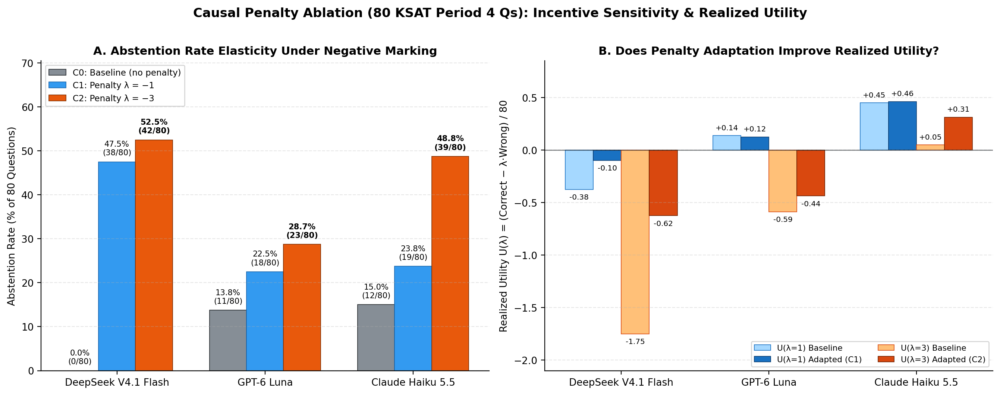
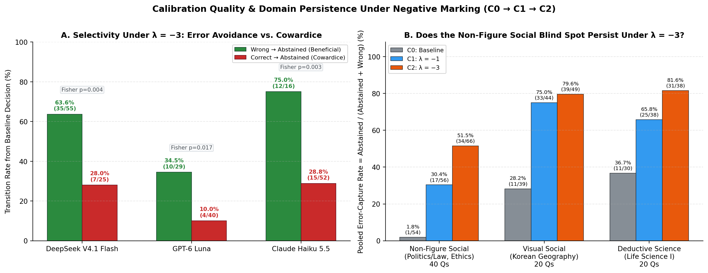

# 후속 인과 실험 보고서: 기권 0점·오답 감점제는 LLM의 행동을 바꾸는가?

2026-11-25 · 2027학년도 수능 4교시 4과목(80문항) 통제 대조 실험 · 기존 `results/` 및 대시보드와 완전 격리

---

## 핵심 결론 (Executive Summary)

*"기권은 0점, 오답은 마이너스 점수(-1점 또는 -3점)"*라는 명시적 채점 규칙을 부여하자, **3개 모델 모두에서 기권 행동이 통계적으로 유의하게 급변했다**(C0 → C2 McNemar 검정: 전 모델 $p \le 0.0042$). 더 나아가 감점 조건에서의 행동 변화는 단순한 무작위 회피가 아니라 **오답을 정답보다 2.3–5.4배 더 높은 비율로 골라 기권하는 정밀한 선택적 적응**이었으며, 3개 모델 모두 $\lambda=3$ 환경에서 실현 효용($U_3$)을 크게 끌어올렸다.

1. **무(無)기권 모델의 잠재 메타인지 발견:** 베이스라인(C0)에서 80문항 중 **55문항을 틀리며 기권 0건**이었던 `deepseek-v4.1-flash`는 `-1점` 감점(C1)만으로 **38/80건(47.5%)** 기권으로 전환했다(McNemar $p=7.28\times 10^{-12}$). `-3점`(C2)에서는 기존 오답의 **63.6%(35/55)**를 기권으로 걸러내며(기존 정답 포기 28.0%, 선택성 2.27배, Fisher $p=0.0039$), $\lambda=3$ 실현 효용이 **-1.750 → -0.625(+1.125)**로 극적으로 개선되었다. 즉, 기본 시험에서의 무기권은 메타인지 부재가 아니라 **사후학습으로 형성된 기본 추측 편향(억제된 잠재 메타인지)**이었다.
2. **모델별 적응 곡선과 과잉 기권(Cowardice) 트레이드오프:**
   * `claude-haiku-5-5`는 `-1점`에서 선택성 **5.42배**(오답 31.3% vs 정답 5.8%, $p=0.0146$), `-3점`에서는 오답을 **16개 → 단 4개**로 억제하며 **응답 문항 정답률 90.2%·ECR 90.7%·$U_3$ +0.263 개선**을 달성했다. 다만 `-3점`에서는 기존 정답의 28.8%(15/52)까지 포기하는 보수성 비용이 동반되었다.
   * `gpt-6-luna`는 `-1점`에서 비선택적 흔들림(선택성 1.03배, $\Delta U_1=-0.013$)을 보였으나, 강한 `-3점` 감점에서는 선택성 **3.45배**($p=0.0167$, $\Delta U_3=+0.150$)로 정밀 적응했다.
3. **비도표 사회탐구 사각지대의 이중 판결 (대폭 완화 + 잔존 격차):**
   * 감점을 주자 비도표 사회탐구(`정치와 법`, `윤리와 사상`)의 통합 오답 포착률(ECR)이 **1.9%(C0) → 30.4%(C1) → 51.5%(C2)**로 28배 가까이 상승했다.
   * **그러나 `-3점`의 강한 감점 아래에서도** 과학탐구(81.6%)·도표 사탐(79.6%) 대비 비도표 사탐(51.5%)의 격차는 여전히 **OR = 4.17($p=0.0030$)**으로 통계적 유의성을 유지했다. 즉, 선행 연구의 30.7배 영역 격차는 **약 85%가 인센티브·임계값 효과, 나머지 4.2배가 구조적 사각지대(Unknown Unknowns)**로 분해된다.

---

## 1. 실험 설계 및 실행 요약

동일한 2027학년도 수능 4교시 4과목(**80문항**, 비도표 사탐 `정치와 법`·`윤리와 사상` 40문항 + 도표 사탐 `한국지리` 20문항 + 연역 과탐 `생명과학 I` 20문항)과 동일한 200 DPI 무손실 시험지 이미지, 동일한 도구 차단(Closed-Book) 환경을 고정하고 채점 규칙만 조작했다([PLAN.md](PLAN.md)).

* **C0 (`baseline`):** 기존 동결 2027 4교시 실행 결과 (감점 미명시, 추가 호출 0회)
* **C1 (`penalty_1`, $\lambda=1$):** 정답 `+1점`, 기권 `0점`, 오답 `-1점` (확신 50% 이하 기권 지시)
* **C2 (`penalty_3`, $\lambda=3$):** 정답 `+1점`, 기권 `0점`, 오답 `-3점` (확신 75% 이하 기권 지시)
* **실행 결과:** 3모델 × 2신규 조건 × 4그룹 = **24회 그룹 요청 전원 1회차 80/80 완주(오류 0건)**. DeepSeek API 참고 비용 합계 `$0.4805`, Codex/Claude 구독 전용 추가 과금 `$0`.

---

## 2. 조건별 성능 및 실현 효용 변화



| 모델 | 조건 | 정답 | 오답 | 기권 | 전체 정답률 | 선택적 정답률 ($A_{\text{sel}}$) | 오답 포착률 (ECR) | $U_1$ ($\lambda=1$) | $U_3$ ($\lambda=3$) |
| --- | --- | ---: | ---: | ---: | ---: | ---: | ---: | ---: | ---: |
| `deepseek-v4.1-flash` | C0 baseline | 25 | 55 | **0** | 31.2% | 31.2% | 0.0% | -0.375 | -1.750 |
| `deepseek-v4.1-flash` | C1 penalty (-1) | 17 | 25 | **38** | 21.2% | 40.5% | 60.3% | **-0.100** *(+0.275)* | -0.725 |
| `deepseek-v4.1-flash` | C2 penalty (-3) | 16 | 22 | **42** | 20.0% | **42.1%** | **65.6%** | -0.075 | **-0.625** *(+1.125)* |
| `gpt-6-luna` | C0 baseline | 40 | 29 | **11** | 50.0% | 58.0% | 27.5% | +0.138 | -0.588 |
| `gpt-6-luna` | C1 penalty (-1) | 36 | 26 | **18** | 45.0% | 58.1% | 40.9% | +0.125 *(-0.013)* | -0.525 |
| `gpt-6-luna` | C2 penalty (-3) | 34 | 23 | **23** | 42.5% | **59.7%** | **50.0%** | +0.138 | **-0.438** *(+0.150)* |
| `claude-haiku-5-5` | C0 baseline | 52 | 16 | **12** | 65.0% | 76.5% | 42.9% | +0.450 | +0.050 |
| `claude-haiku-5-5` | C1 penalty (-1) | 49 | 12 | **19** | 61.3% | 80.3% | 61.3% | **+0.463** *(+0.013)* | +0.163 |
| `claude-haiku-5-5` | C2 penalty (-3) | 37 | **4** | **39** | 46.2% | **90.2%** | **90.7%** | +0.412 | **+0.312** *(+0.263)* |

---

## 3. 문항별 3×3 전이 분석: 정밀한 오답 회피 vs 과잉 기권(Cowardice)



동일 80문항에 대한 C0 → C1 및 C0 → C2 전이 행렬은 새로 늘어난 기권이 정말 '모르던 문항(기존 오답)'을 겨냥했는지, 아니면 '알던 문항(기존 정답)'까지 무차별 포기했는지 직접 판별한다.

| 모델 | 비교 | 유익한 기권 (`W → A`) | 과잉 기권 (`C → A`) | 선택성 비율 ($p_{\text{WA}}/p_{\text{CA}}$) | 선택성 Fisher $p$ | 기권 증가 McNemar $p$ | 목표 $\lambda$ 순효용 변화 ($\Delta U_\lambda$) |
| --- | --- | :---: | :---: | :---: | :---: | :---: | ---: |
| `deepseek-v4.1-flash` | C0 → C1 (-1) | **31 / 55** (56.4%) | 7 / 25 (28.0%) | **2.01×** | `0.0289` | `7.28e-12` | **+0.275** |
| `deepseek-v4.1-flash` | C0 → C2 (-3) | **35 / 55** (63.6%) | 7 / 25 (28.0%) | **2.27×** | **`0.0039`** | `4.55e-13` | **+1.125** |
| `gpt-6-luna` | C0 → C1 (-1) | 3 / 29 (10.3%) | 4 / 40 (10.0%) | 1.03× | `1.000` | `0.0156` | -0.013 |
| `gpt-6-luna` | C0 → C2 (-3) | **10 / 29** (34.5%) | 4 / 40 (10.0%) | **3.45×** | **`0.0167`** | `0.0042` | **+0.150** |
| `claude-haiku-5-5` | C0 → C1 (-1) | **5 / 16** (31.3%) | 3 / 52 (5.8%) | **5.42×** | **`0.0146`** | `0.0391` | **+0.013** |
| `claude-haiku-5-5` | C0 → C2 (-3) | **12 / 16** (75.0%) | 15 / 52 (28.8%) | **2.60×** | **`0.0026`** | `1.49e-08` | **+0.263** |

* **과목별 극적 사례:**
  * `deepseek-v4.1-flash`는 `한국지리`에서 C0(`C2/W18/A0`) → C1(`C2/W2/A16`)으로 **정답을 단 1개도 잃지 않고 오답 18개 중 16개를 기권으로 제거**했고, `생명과학 I`에서도 C0(`C5/W15/A0`) → C1(`C5/W6/A9`)으로 **정답 손실 0건에 오답 9개 제거**에 성공했다.
  * `claude-haiku-5-5`는 `생명과학 I`에서 C1(`C12/W0/A8`)·C2(`C9/W0/A11`) 모두 **오답 0건(응답 정답률 100%)**을 달성했고, 비도표 사탐인 `윤리와 사상`에서도 C0(`C12/W7/A1`) → C2(`C10/W1/A9`)로 오답을 7개 → 1개로 줄였다.

---

## 4. 영역별 감점 탄력성과 기권 해설의 질적 전환

### 4.1 비도표 사탐 vs 도표 사탐 vs 과탐 (3모델 통합 ECR)

| 조건 | 비도표 사탐 (`정법`·`윤사`, 40문항) | 도표 사탐 (`한국지리`, 20문항) | 연역 과탐 (`생명과학 I`, 20문항) | 과탐 vs 비도표 사탐 Fisher |
| --- | :---: | :---: | :---: | :---: |
| **C0 (baseline)** | **1.9%** (1 / 54) | 28.2% (11 / 39) | 36.7% (11 / 30) | **OR = 30.68, $p=2.69\times 10^{-5}$** |
| **C1 (λ = -1)** | **30.4%** (17 / 56) | 75.0% (33 / 44) | 65.8% (25 / 38) | **OR = 4.41, $p=0.0014$** |
| **C2 (λ = -3)** | **51.5%** (34 / 66) | 79.6% (39 / 49) | 81.6% (31 / 38) | **OR = 4.17, $p=0.0030$** |

* 모델별 편차도 뚜렷하다: `gpt-6-luna`는 `-3점` 감점에서도 `정치와 법`에서 여전히 **오답 8 · 기권 2**에 머물렀고, `deepseek-v4.1-flash`는 `정치와 법`에서는 기권 11–12건으로 강하게 반응했지만 `윤리와 사상`에서는 C1 1건 · C2 4건에 그쳤다.

### 4.2 기권 해설의 질적 변화 (개념·법규 불확실성 언어의 출현)
선행 관찰 연구(C0)에서는 기권 해설 187건 중 85%가 연역·시각 판독 실패였고 순수 개념·지식 불확실성은 1.6%뿐이었다. 그러나 감점 조건(C1·C2)에서 새로 발생한 기권 136건을 감사한 결과, 기존 제약·시각 분류기에 걸리지 않던 **개념·법규·사상 진위 불확실성 표현**이 대거 등장했다(C1 21건, C2 38건):
* *"국제법규 A~C의 구체적 내용을 확정하기 어려워 기권합니다."* (`deepseek-v4.1-flash`, `정치와 법`, C1)
* *"미성년자의 계약 취소와 최고권에 관한 구체적 사실관계를 확정하기 어렵다."* (`deepseek-v4.1-flash`, `정치와 법`, C2)
* *"사단칠정 논변의 세부 선택지 내용을 충분히 확신할 수 없어 기권한다."* (`deepseek-v4.1-flash`, `윤리와 사상`, C2)
* *"아리스토텔레스 행복론에 대한 선택지의 세부 진위를 충분히 확신할 수 없어 기권한다."* (`deepseek-v4.1-flash`, `윤리와 사상`, C2)

즉, **감점 인센티브는 모델 내부에 잠재해 있던 '개념적 확신 부족' 신호를 언어화·기권 행동으로 끌어올리는 촉매로 작동**했다.

---

## 5. 한계 및 재현 방법

* **한계:** 3개 모델 × 4개 과목(80문항) 표본이므로 최상위 프론티어 모델(정답률 98–99%대)의 극소수 오답 구간이나 타 과목(역사·화학·물리)으로의 일반화는 추가 검증이 필요하다. 또한 C1/C2 프롬프트에는 감점 수치와 함께 이론적 확신 임계값(50%, 75%)이 병기되어 있으므로, 향후 순수 감점 문구만으로 모델이 임계값을 자체 계산할 수 있는지 분리 실험할 수 있다.
* **재현 및 검증:**
```bash
python3 research/metacognitive-abstention/ablation-penalty/analyze_ablation.py
python3 research/metacognitive-abstention/ablation-penalty/plot_ablation.py
python3 -m unittest discover -s research/metacognitive-abstention/ablation-penalty -p 'test_*.py' -v
python3 research/metacognitive-abstention/ablation-penalty/verify_ablation.py
```
